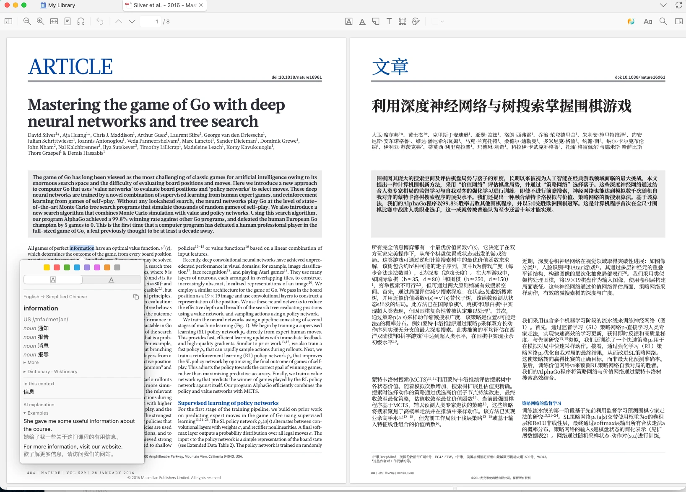
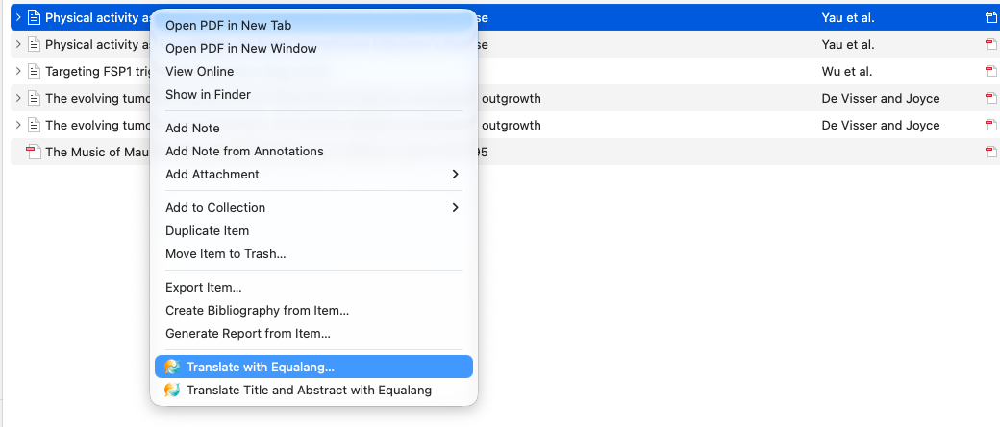

# Extension de traduction Equalang pour Zotero

[English](../README.md) · [简体中文](README.zh-CN.md) · [繁體中文](README.zh-TW.md) · [日本語](README.ja.md) · [한국어](README.ko.md) · [Español](README.es.md) · **Français** · [Deutsch](README.de.md) · [Português](README.pt.md) · [Italiano](README.it.md) · [Русский](README.ru.md) · [Polski](README.pl.md) · [Türkçe](README.tr.md) · [Tiếng Việt](README.vi.md) · [Bahasa Indonesia](README.id.md) · [ไทย](README.th.md) · [हिन्दी](README.hi.md) · [العربية](README.ar.md)

[Télécharger la dernière version](https://github.com/equalang/equalang-zotero-plugin/releases/latest) · [Site officiel](https://equalang.com/fr/extension/zotero?utm_source=github) · [Tarifs](https://equalang.com/fr/pricing?utm_source=github) · [Journal des modifications](../CHANGELOG.md)

> **Mots-clés :** extension de traduction Zotero, traduction PDF Zotero, traduction de littérature scientifique, traduction d'articles académiques, traduction PDF conservant la mise en page, bilingue côte à côte, traduction de sélection, traduction Word, traduction PPT, traduction Excel, traduction académique, zotero plugin, zotero translate, pdf translator

**Traduisez en un clic, lisez côte à côte.** L'extension Equalang pour Zotero permet de traduire des documents comme les PDF ainsi que le texte que vous sélectionnez : faites un clic droit sur une pièce jointe pour traduire l'article complet, la traduction conserve la mise en page d’origine et s'ajoute sous la référence d’origine ; dans le lecteur, sélectionnez du texte pour afficher instantanément sa traduction et ses définitions dans une infobulle.

## Fonctionnalités

- **Traduction de documents** : Faites un clic droit sur une pièce jointe PDF, Word, PowerPoint ou Excel pour la traduire. La traduction conserve la mise en page d’origine et s’ajoute sous la référence d’origine ; les PDF peuvent aussi être générés en version bilingue pour lire l'original et la traduction côte à côte.
- **Traduction de sélection** : Sélectionnez du texte dans le lecteur pour afficher aussitôt la traduction dans une infobulle ; la sélection d'un mot affiche également ses définitions, sa transcription phonétique et des exemples.
- **Traduction en arrière-plan** : Vous pouvez quitter Zotero à tout moment ; les tâches non terminées reprendront au prochain démarrage et la traduction sera bien ajoutée sous la référence d'origine.
- **Crédits partagés avec le site** : Avant chaque traduction de document, les crédits estimés et votre solde actuel s’affichent ; une tâche annulée ne coûte rien.

## Installation

1. **Télécharger le fichier de l'extension** : Rendez-vous sur la [page Releases](https://github.com/equalang/equalang-zotero-plugin/releases/latest) et téléchargez la dernière version de `equalang.xpi` ; il n’est pas nécessaire de le décompresser.
2. **Ouvrir le gestionnaire d'extensions de Zotero** : Dans le menu de Zotero, sélectionnez « Outils → Extensions ».
3. **Installer à partir du fichier** : Cliquez sur l’icône d’engrenage en haut à droite, choisissez « Install Plugin From File… », puis sélectionnez le fichier que vous venez de télécharger ; vous pouvez aussi glisser-déposer directement le fichier dans cette fenêtre d'extensions.
4. **Se connecter à Equalang** : Une fois l’extension installée, une fenêtre d’accueil s’ouvre. Cliquez sur « Se connecter ou s'inscrire » et terminez la connexion dans votre navigateur. Les nouveaux comptes reçoivent des crédits offerts.

Par la suite, l’extension se met à jour automatiquement avec Zotero ; vous pouvez aussi rechercher des mises à jour manuellement dans le menu d’engrenage sous « Outils → Extensions ».

## Utilisation

- **Traduire des documents** : Faites un clic droit sur une référence ou une pièce jointe, choisissez « Traduire avec Equalang… », confirmez la langue cible et les crédits estimés pour démarrer. La progression s’affiche dans le volet « Equalang » à droite ou dans « Outils → Equalang → Tâches de traduction… ».

  

- **Lecture bilingue côte à côte** : Ouvrez la version bilingue, puis choisissez dans le lecteur « Affichage → Double affichage → Pair » pour afficher le texte original et la traduction côte à côte.
- **Traduction de sélection** : Sélectionnez simplement du texte dans le lecteur. Vous pouvez aussi choisir dans les paramètres « Afficher d'abord le bouton Traduire » pour ne traduire qu'après avoir cliqué.
- **Paramètres** : Dans « Outils → Equalang → Paramètres... », vous pouvez configurer la langue cible, choisir entre version bilingue ou traduction seule pour les PDF, définir l'emplacement de sauvegarde des fichiers traduits, choisir « Ouvrir la traduction une fois terminée », et activer l'optimisation de la mise en page des formules dans les PDF (consomme des crédits supplémentaires).

## Questions fréquentes

**Quelles versions de Zotero et quels systèmes d’exploitation sont pris en charge ?**

Elle prend en charge Zotero 7, 8, 9 et 10, aussi bien sur Windows que sur macOS.

**Comment fonctionne la tarification ?**

L'installation de l'extension est gratuite. Elle partage le même solde de crédits que le site web d'Equalang et applique les [tarifs du site](https://equalang.com/fr/pricing?utm_source=github). Avant chaque traduction de document, les crédits estimés et votre solde actuel s’affichent ; une tâche annulée ne coûte rien. Les nouveaux comptes reçoivent des crédits offerts.

**Où sont enregistrés les fichiers traduits ?**

Le fichier traduit d’un document est placé par défaut en pièce jointe sous la référence d’origine et se synchronise avec Zotero ; vous pouvez aussi choisir dans les paramètres de l’enregistrer dans un dossier sur votre ordinateur, puis de le lier à la référence (dans « Ma bibliothèque » uniquement).

## Liens

- [Site officiel d'Equalang](https://equalang.com/fr?utm_source=github) · [Page de l'extension Zotero](https://equalang.com/fr/extension/zotero?utm_source=github) · [Tarifs](https://equalang.com/fr/pricing?utm_source=github) · [Politique de confidentialité](https://equalang.com/fr/legal/privacy?utm_source=github) · [Conditions d'utilisation](https://equalang.com/fr/legal/terms?utm_source=github)
- [Extension de navigateur Equalang](https://equalang.com/fr/extension?utm_source=github) : traduction de pages web, sous-titres de vidéos et bandes dessinées
- Une question ? : <support@equalang.com>

Ce dépôt met à disposition les paquets d'installation de l'extension (voir [Releases](https://github.com/equalang/equalang-zotero-plugin/releases)) et son journal des modifications.
